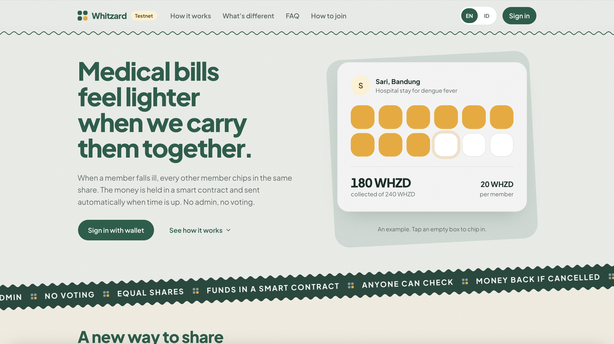
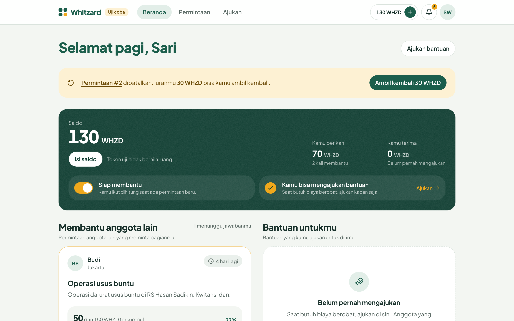
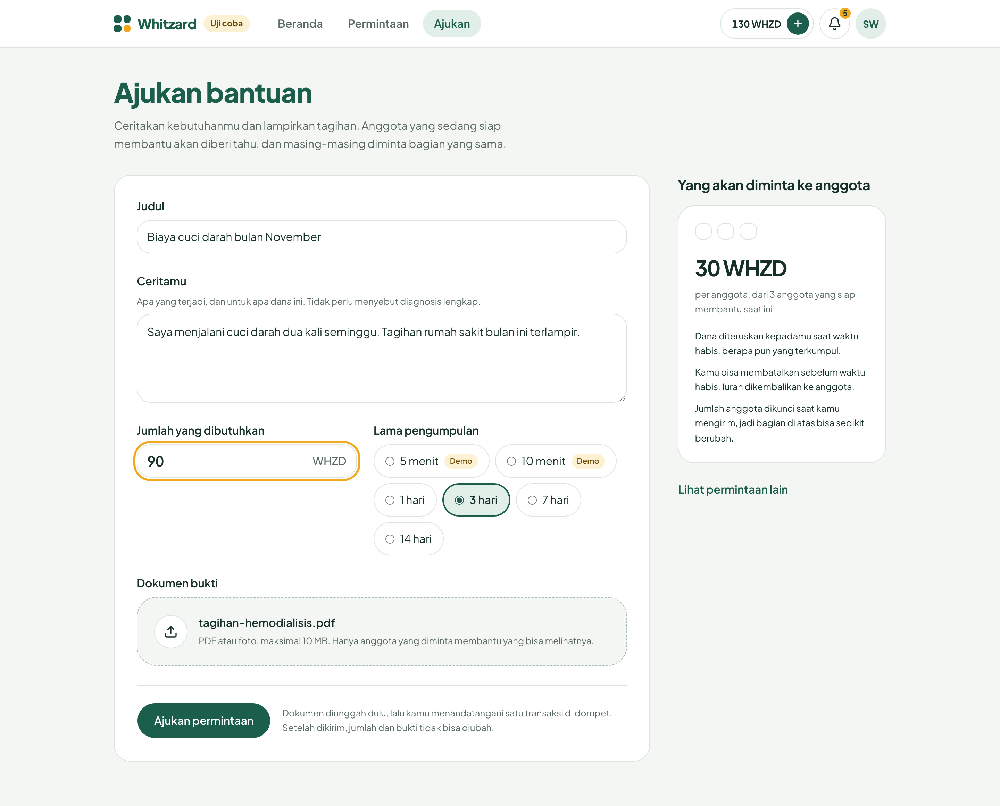
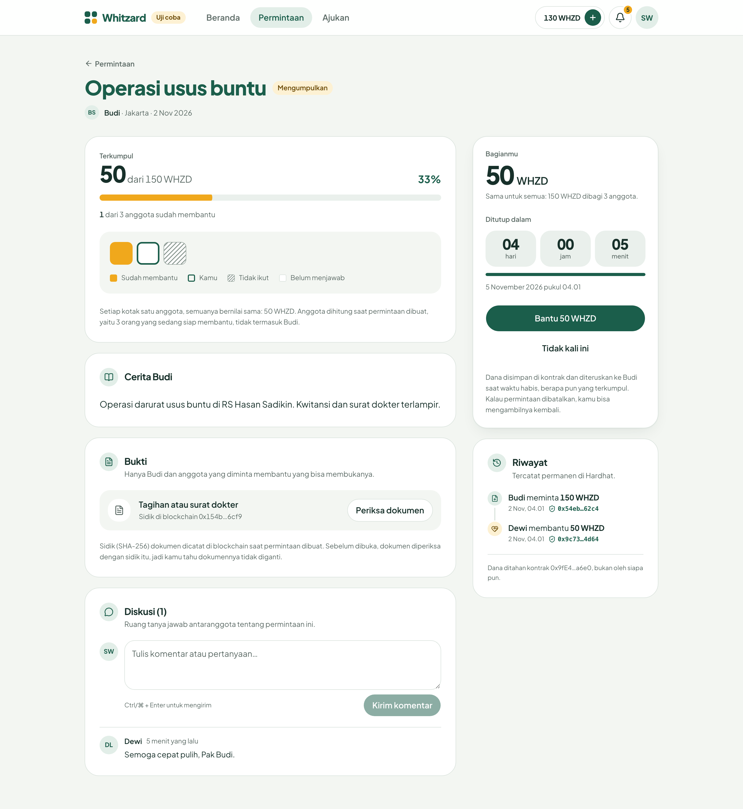
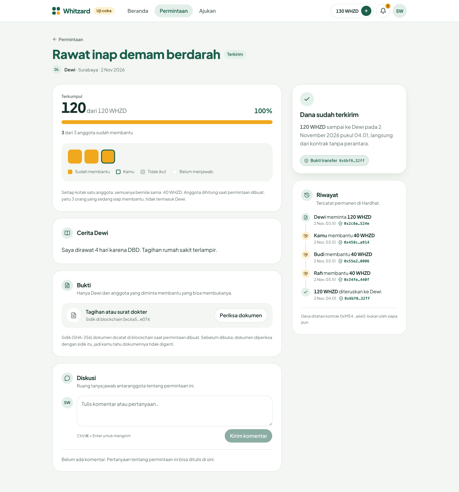
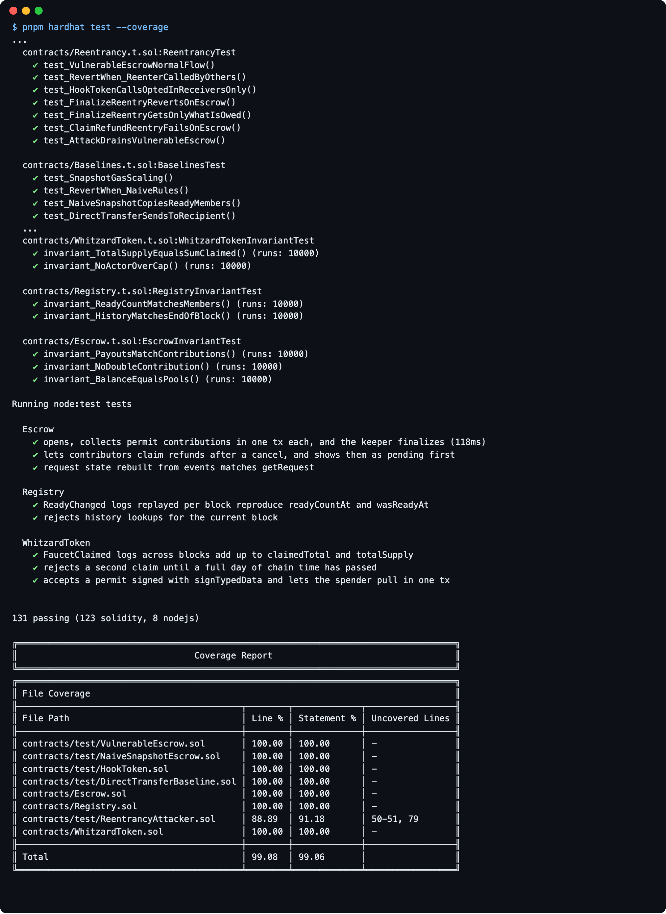

# Whitzard

   

**Automated escrow smart contract for transparent community health aid.**

A member asks for help. Every member who is _Ready_ at that moment chips in the same fixed share.
An Escrow contract holds the money and pays it to the requester when the request's time is up.
No admin, no voting, no manual approval: the rules are the code, and every step is on-chain.



Whitzard is a finished MVP: a working proof that the idea holds up end to end. It runs on the Sepolia
testnet with tokens that have no monetary value, and there are no plans to take it to mainnet or real money.

## How it works

1. **Get tokens.** Members claim test tokens from the public faucet.
2. **Register and go Ready.** Members choose whether they're counted for new requests.
3. **Open a request.** The requester sets the amount and duration and attaches a hash of the evidence document.
   The contract snapshots the Ready members and computes the share: `amount / n`.
4. **Contribute.** Each member in the snapshot pays exactly one share, in one transaction (EIP-2612 permit).
5. **Finalize.** After the deadline anyone can call `finalize()`, and the requester receives everything collected,
   even if the request was only partly funded.
6. **Or cancel.** Before the deadline the requester can cancel, and each contributor claims their share back.

## Screenshots

The app supports English and Indonesian; these screenshots show the Indonesian version.

<table>
  <tr>
    <td width="50%"><br><sub><b>Dashboard</b>: balance, Ready status, and requests waiting for your share.</sub></td>
    <td width="50%"><br><sub><b>New request</b>: story, amount, duration and evidence; the share per member is shown live.</sub></td>
  </tr>
  <tr>
    <td width="50%"><br><sub><b>Collecting</b>: one box per member in the snapshot, a countdown, and the on-chain history.</sub></td>
    <td width="50%"><br><sub><b>Sent</b>: after the deadline the contract pays the requester, with a link to the transfer.</sub></td>
  </tr>
</table>

<details>
<summary>Contract tests: 131 passing, 99% line coverage</summary>



</details>

## Repository

| Folder                       | What                                                   | Stack                       | Status         |
| ---------------------------- | ------------------------------------------------------ | --------------------------- | -------------- |
| [`blockchain/`](blockchain/) | Token, Registry, Escrow contracts + tests              | Solidity, Hardhat 3, viem   | Contracts done |
| [`backend/`](backend/)       | REST API, event indexer, `finalize()` keeper, evidence | Go, go-ethereum, PostgreSQL | Done           |
| [`frontend/`](frontend/)     | Demo UI: wallet sign-in, requests, history, dashboard  | Next.js, wagmi              | Working demo   |
| [`docs/`](docs/)             | [Architecture](docs/architecture.md) and [design decisions](docs/design-decisions.md) |  |  |

The backend never holds member keys or moves funds. Users sign every transaction in their own wallet.

**Network:** Sepolia testnet (chain ID `11155111`). The tokens have no real value.

## Quick start

Contracts and their tests:

```shell
cd blockchain
pnpm install
pnpm hardhat test
```

The whole stack on a local chain (PostgreSQL in Docker, Hardhat node, contracts, backend):

```shell
cd backend && ./scripts/dev.sh        # runs until Ctrl-C
cd frontend && pnpm install && pnpm dev   # in another terminal → http://localhost:3000
```

Against Sepolia instead, see [`backend/README.md`](backend/README.md) and
[`frontend/README.md`](frontend/README.md). Contracts in depth: [`blockchain/README.md`](blockchain/README.md).
