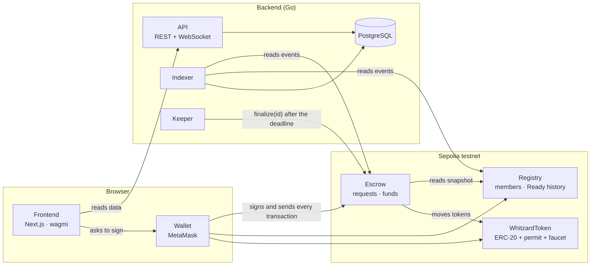
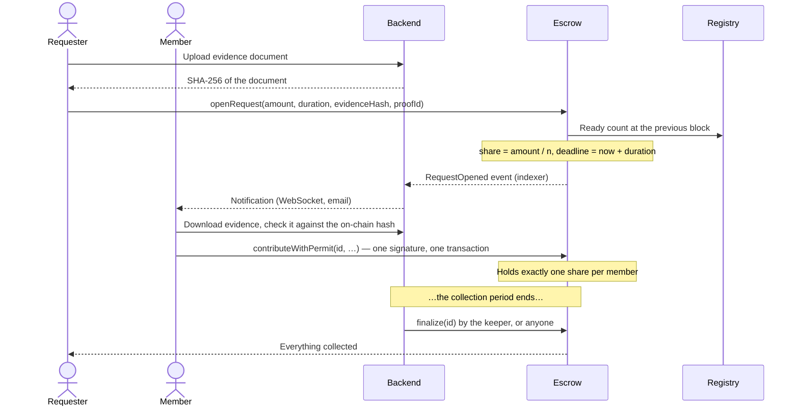
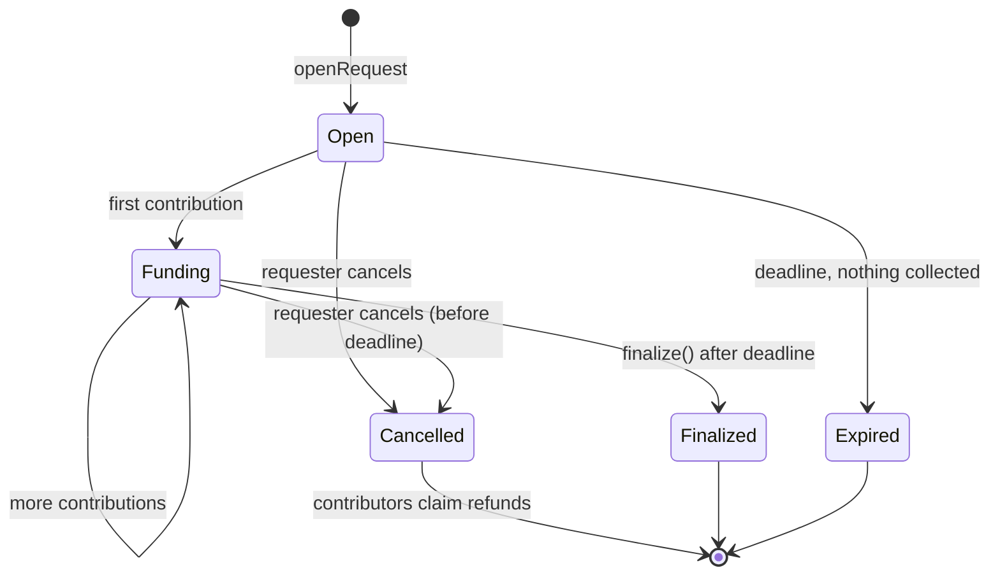

# Architecture

Whitzard has three parts. The **contracts** hold the rules and the money. The **backend** and
**frontend** only make the contracts easier to use: if both disappeared, every request could still
be contributed to, finalized and refunded straight from a wallet or Etherscan.

| Part                               | Responsibility                                                                      | Trust                                                       |
| ---------------------------------- | ----------------------------------------------------------------------------------- | ----------------------------------------------------------- |
| `WhitzardToken`                    | Test ERC-20 with EIP-2612 permit and a public faucet. No owner, no mint.             | None needed: fixed rules                                    |
| `Registry`                         | Who is a member, and who was _Ready_ at every past block                             | None needed: fixed rules                                    |
| `Escrow`                           | Opens requests, takes contributions, pays out, refunds. The only holder of funds.   | None needed: fixed rules, no admin                          |
| Indexer                            | Mirrors contract events into PostgreSQL and creates notifications                   | Read-only; anyone can rebuild it from the chain            |
| API                                | Sign-in (SIWE), profiles, evidence files, request lists, notifications              | Holds no keys, moves no funds                               |
| Keeper                             | Calls `finalize(id)` once a funded request's time is up                             | Its wallet only pays gas; anyone else can call it too      |
| Frontend                           | The UI; builds transactions for the member's wallet to sign                         | Holds no keys                                               |

## A request, end to end

If the requester cancels before the deadline, nothing is paid out. Each contributor calls
`claimRefund(id)` to take back exactly their share.

## Request status

## What lives where

| On-chain (public, permanent)                          | Off-chain in PostgreSQL (backend)                          |
| ----------------------------------------------------- | ---------------------------------------------------------- |
| Membership and _Ready_ history                        | Profiles: name, city, photo, email                         |
| Request amount, share, deadline, snapshot block       | Request title and story                                    |
| SHA-256 of the evidence document                      | The evidence document itself                               |
| Every contribution, payout and refund                 | Notifications, comments, "declined" answers                |

Anything that decides who gets paid is on-chain. Personal data stays off-chain, and the evidence is
tied to the chain by its hash, so the backend can serve the document but cannot swap it.
